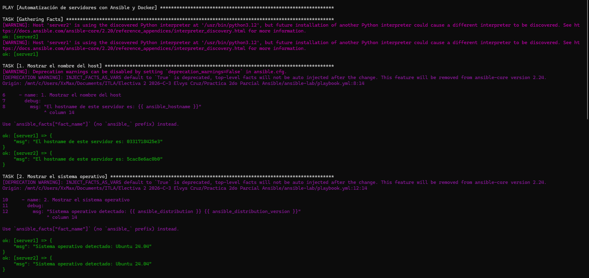
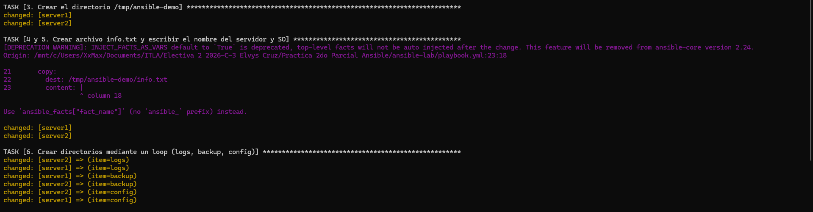
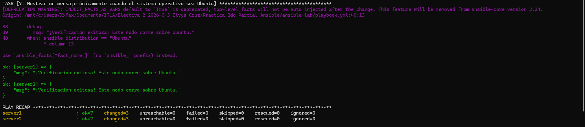

# Laboratorio de Automatización con Ansible y Docker

## 🎯 Objetivo de la Práctica
Configurar un entorno virtualizado utilizando contenedores Docker para simular dos servidores Ubuntu (Ubuntu 24.04), e implementar playbooks de Ansible orientados a la gestión automatizada de configuraciones, creación de directorios, manejo de archivos y aplicación de condiciones basadas en el sistema operativo.

---

## 🛠️ Requisitos Previos
Asegúrate de contar con las siguientes herramientas instaladas en tu entorno (recomendado WSL / Ubuntu):
- Docker y Docker Compose
- Ansible (instalado en el entorno de control / WSL)

---

## 📁 Estructura del Proyecto
```text
ansible-lab/
├── docker-compose.yml    # Definición de los 2 contenedores Ubuntu
├── inventory.ini         # Inventario con la conexión nativa de Docker para Ansible
├── playbook.yml          # Tareas automatizadas de configuración
└── README.md             # Documentación de la práctica
```

---

## 🚀 Comandos para Iniciar los Contenedores
1. Levantar los servidores virtuales en segundo plano:
   ```bash
   docker compose up -d
2. Verificar que los contenedores estén en ejecución:
    ```bash
    docker ps
3. Instalar el intérprete de Python (requerido para los módulos de Ansible) en cada contenedor:
    ```bash
    docker exec -it server1 apt update && docker exec -it server1 apt install -y python3
    docker exec -it server2 apt update && docker exec -it server2 apt install -y python3
4. Comprobar la conectividad desde Ansible:
    ```bash
    ansible docker -i inventory.ini -m ping
---

## ⚙️ Comando para Ejecutar el Playbook
Una vez configurado el inventario y los contenedores, ejecuta el playbook con el siguiente comando desde la raíz del proyecto en tu terminal de WSL:

```bash
ansible-playbook -i inventory.ini playbook.yml
```

---

## 📸 Captura de Pantalla de la Ejecución Exitosa
A continuación se muestra el resultado de la ejecución exitosa del playbook en los servidores:



